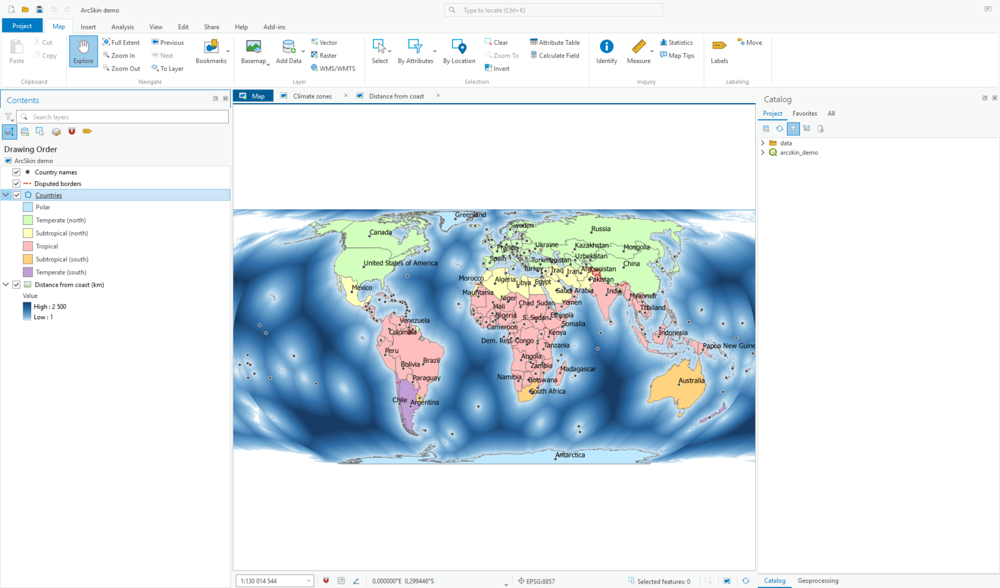
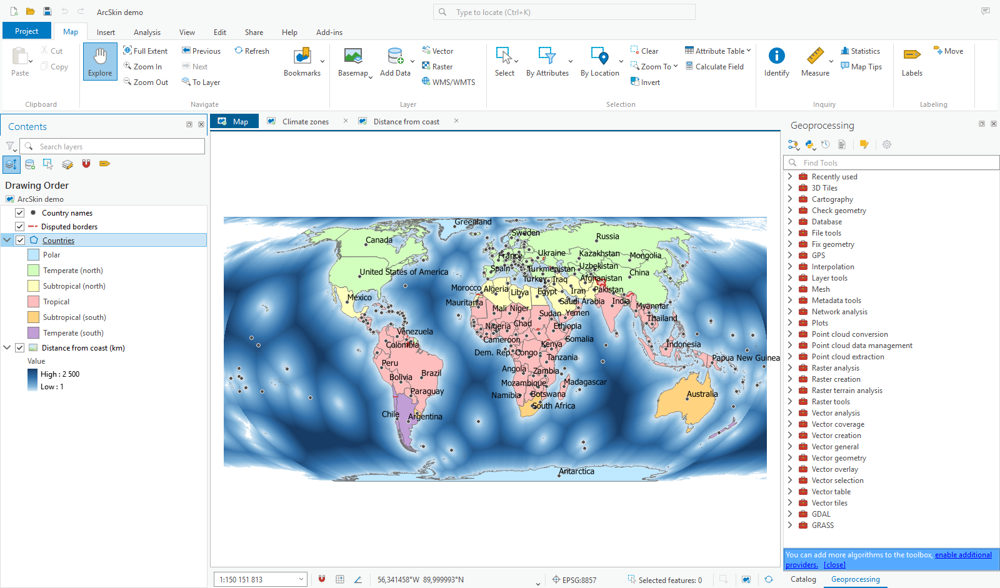
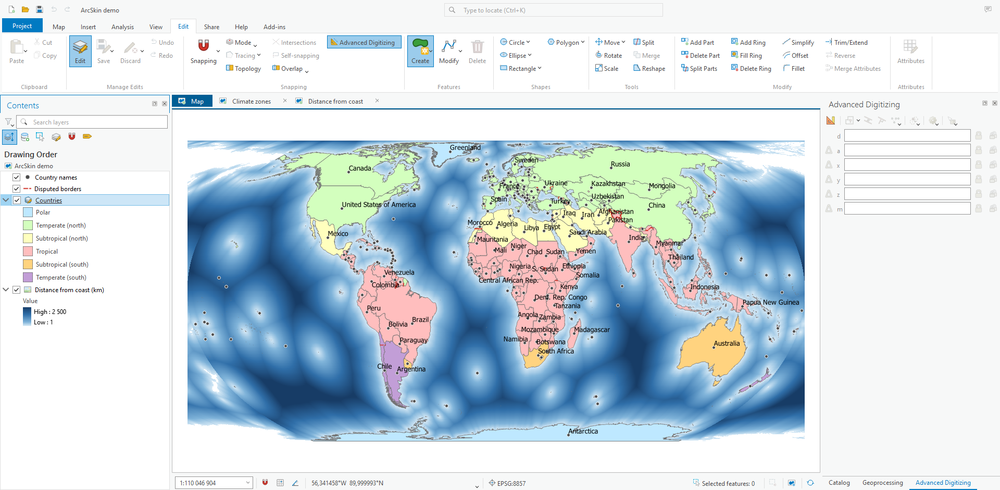
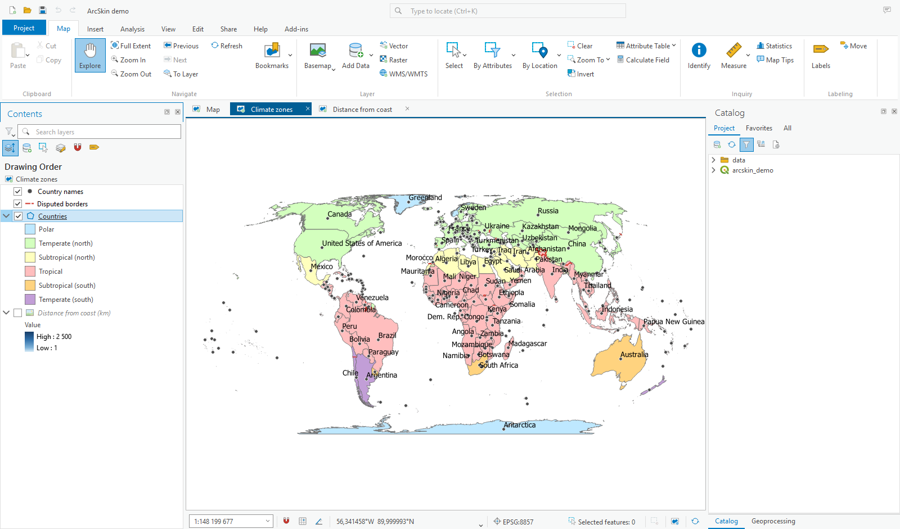
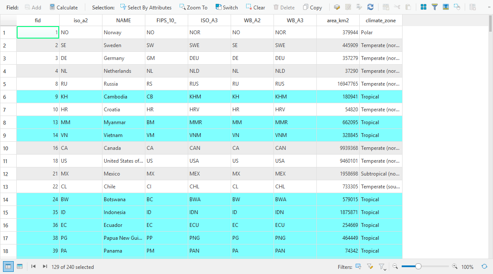
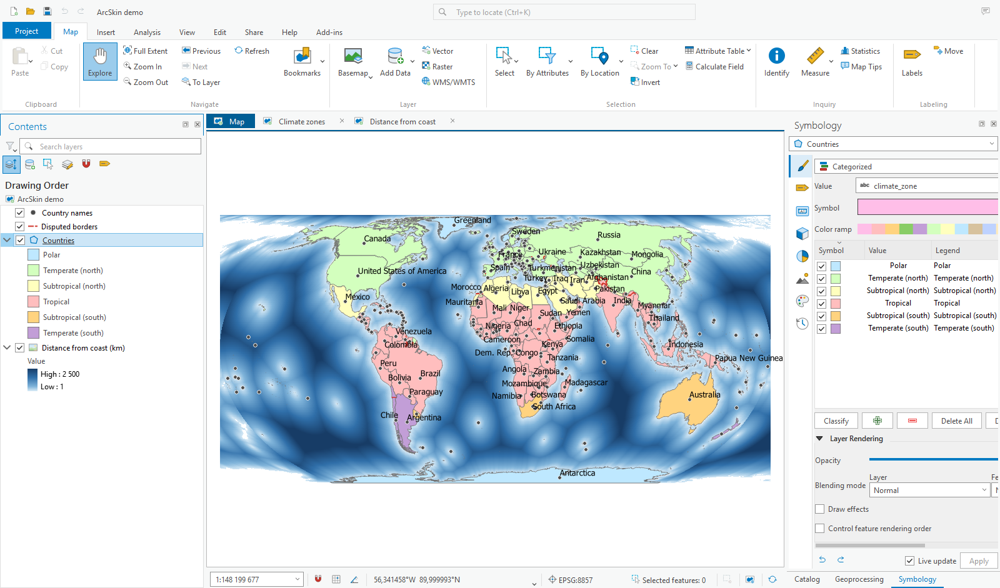
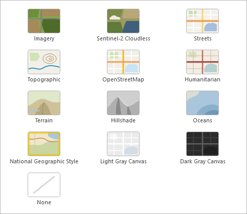

# ArcSkin

[](https://github.com/envirosolutionspl/arcskin/actions/workflows/tests.yml)
[](https://github.com/envirosolutionspl/arcskin/actions/workflows/qt5-qt6-compat.yml)
[](https://github.com/envirosolutionspl/arcskin/actions/workflows/security_and_quality.yml)
[](https://github.com/envirosolutionspl/arcskin/actions/workflows/release.yml)
[](https://github.com/envirosolutionspl/arcskin/releases/latest)
[](https://plugins.qgis.org/plugins/arcskin/)

**ArcSkin gives QGIS an interface inspired by ArcGIS Pro**: a ribbon, Pro-style
panes, view tabs above the map, Pro's map status bar, light flat icons for the whole
of QGIS, Pro's default symbology and colour ramps. Everything is switched on with one
click and fully reverted with the next one.

It is meant for people who know ArcGIS Pro and want to feel at home in QGIS, for
training rooms that teach both, and for organisations moving from Esri to QGIS.



> ArcSkin is an independent open source project. It is not affiliated with,
> sponsored or endorsed by Esri. ArcGIS and ArcGIS Pro are trademarks of Esri.

## Features

**Ribbon and title row**

- Ribbon with *Map*, *Insert*, *Analysis*, *View*, *Edit*, *Share*, *Help* and
  *Add-ins* tabs built from QGIS's own tools, with Pro's captions and grouping.
  Plugin toolbars appear on *Add-ins*.
- Nothing of QGIS is out of reach: buttons drop down QGIS's own menus
  (*Analysis → Tools*: Vector, Raster, Database, Web, Mesh; *View → Panes* with
  every panel, plugin ones too; *Toolbars*; *Insert → Decorations*; *Add Data*,
  *New Layer*, *Select*, *Help*, *Plugins*), so items that plugins add to them
  show up as well.
- *Edit* tab with all of QGIS's editing tools: digitizing techniques (curves,
  stream, Bézier, NURBS), shapes (circle, ellipse, rectangle, regular polygon),
  the advanced digitizing tools (parts, rings, simplify, offset, fillet,
  trim/extend, reverse, split parts, merge attributes), the *Advanced
  Digitizing* panel and every snapping option (types, layers, tracing,
  topological editing, intersections, self-snapping, avoid overlap).
- In a window narrower than a tab, the tab scrolls sideways.
- Blue *Project* button with project commands, recent projects, import/export,
  settings, the complete QGIS menu and the ArcSkin switch.
- Title row with a Quick Access Toolbar, the project name and QGIS's search box
  centred at the top (like Pro's Command Search).
- Basemap gallery: Imagery, Streets, Terrain, Hillshade, Oceans, National
  Geographic Style, Light and Dark Gray Canvas (Esri), Sentinel-2 Cloudless
  (EOX), Topographic (OpenTopoMap), OpenStreetMap and Humanitarian (HOT). Only
  worldwide services that need no API key.

**Panes**

- *Contents* with a layer search box and filter, Pro's *List By* views (drawing
  order, data source, selection, editing, snapping, labeling) and Pro-style
  raster legends ("Value", *High* / *Low*).
- *Catalog* with *Project*, *Favorites* and *All* tabs, *Geoprocessing* with
  toolboxes and *Find Tools*, *Symbology* with Pro page icons.
- The active pane gets Pro's blue title and frame; *View → Reset Panes* restores
  the mapping, editing or geoprocessing layout.





**Map view**

- View tabs above the map. Extra 2D map views are shown in the main map area, one
  at a time: each tab has its own map theme and extent, and the *Contents* pane
  edits the layers of the tab you are on. 3D views and print layouts get tabs too.
- Pro's status bar under the map: editable scale, snapping / grid / constraints,
  coordinates you can type in (decimal degrees, DMS, DDM, MGRS, US National Grid,
  UTM and linear units), the coordinate system, the number of selected features
  (click to zoom to them), clear selection, pause drawing and refresh.
- Attribution strip along the bottom of the map, as in Pro: the credits of the
  layers drawn (the *Rights* in each layer's metadata, filled in for gallery
  basemaps) and "Powered by Esri" while an Esri basemap is shown. Hover it to
  read credits cut short. In a print layout, add a label with the expression
  `[% array_to_string(map_credits('Map 1'), ' | ') %]` (use your map item's
  ID): it collects the same credits for the layers in that map.
- Selected features in Pro's cyan, on the map and in the attribute table.




**Attribute table**

Pro's toolbar (*Field: Add, Calculate | Selection: Select By Attributes, Zoom To,
Switch, Clear, Delete, Copy*) and footer (show all or selected records, first and
last record, "N of M selected", filters, zoom slider, refresh).



**Symbology and styling**

- New layers get Pro's defaults: pastel colours from Pro's "Basic Random" palette,
  0.7 pt grey outlines, 1 pt lines, 4 pt circle markers.
- New labels use Pro's default text symbol (Tahoma 10 pt, black).
- About 100 of Pro's colour ramps (sequential, diverging, analytical such as
  elevation, slope, aspect and precipitation, spectrum and qualitative) are added
  to the QGIS style with the tag *ArcSkin*, for classifying vectors and
  stretching rasters.



**Look and feel**

- Light, flat theme with Segoe UI and Pro-style check boxes, radio buttons, lists
  and trees.
- Every QGIS icon redrawn in Pro's light, flat style, plus hand-drawn icons for
  tools and layer types.
- English interface, Polish translation.



## Requirements

- QGIS 4.x (Qt 6), the main platform
- QGIS 3.40 or newer (Qt 5)

## Installation

From the QGIS plugin repository: *Plugins → Manage and Install Plugins… → All*,
search for **ArcSkin**, click *Install Plugin*. ArcSkin is marked experimental:
tick *Show also experimental plugins* under *Settings* in the same dialog first.

Or from a ZIP file:

1. Download `arcskin-<version>.zip` from the
   [releases](https://github.com/envirosolutionspl/arcskin/releases).
2. In QGIS open *Plugins → Manage and Install Plugins… → Install from ZIP*,
   choose the file and click *Install Plugin*.

The ZIP from GitHub's *Code → Download ZIP* button is the whole repository, not
the plugin: QGIS cannot load it ("No module named 'arcskin-main/arcskin'").

The ArcSkin look is applied as soon as the plugin is installed. Switching takes a
few seconds; a progress box shows the work.

## Turning the look on and off

| What you want | How |
|---|---|
| Switch the look off for now | Blue **Project** button → **ArcSkin look** |
| Switch it on again | **Plugins → ArcSkin → ArcSkin look** (QGIS menu bar) |
| Keep plain QGIS after restarting | **Plugins → Manage and Install Plugins… → Installed**, untick **ArcSkin** |
| Remove the plugin | Same dialog, select **ArcSkin**, **Uninstall Plugin** |

While the plugin is active, ArcSkin is switched on at every QGIS start.

Switching the look off restores QGIS as it was: toolbars, panes and their
positions, the UI theme, icons, the status bar, project styles and the colour ramps
added to the QGIS style. Your projects are not changed by switching.

The first time ArcSkin is switched on, most icons change at once. Layer icons in
*Contents* and *Catalog* follow after a QGIS restart; a message says so.

## Demo project

`demo/arcskin_demo.qgz` is a world map in the Equal Earth projection: countries
coloured by climate zone, country names, disputed borders and a raster of the
distance from the coast, with two extra map views (*Climate zones*, *Distance from
coast*) and a print layout. The data come from Natural Earth (public domain).

## Good to know

- QGIS keeps one layer tree per project, so the drawing order is shared by all view
  tabs; each tab has its own layer visibility (a QGIS map theme) and extent.
- 3D views and print layouts open in their own windows; their tabs bring them to the
  front.
- The icon theme is installed into QGIS's `resources/themes` folder when it is
  writable, because QGIS 4 only reads UI themes from there.

## Development

```
arcskin/                      the plugin (packed into the ZIP)
  plugin.py                   on / off switch, progress box
  stylesheet.py               the skin's block in the application style sheet
  util.py                     tr(), Pro icons, undo log of all changes (Changes)
  ribbon.py                   ribbon, title row, Project menu
  panes.py                    Contents, Catalog, Geoprocessing, Symbology panes
  contents_views.py           List By views, raster legend, context menu icons
  mapview.py                  view tabs, map status bar
  coords.py                   coordinate formats of the status bar
  dialogs.py                  attribute table, Pro icons in other windows
  symbology.py                default symbols, label font, colour ramps
  icon_theme.py               QGIS icon theme
  basemaps.py                 basemap gallery
  resources/                  icons, style sheets, generated icon theme, colour ramps
  i18n/                       translations (.ts sources)
scripts/
  package.py                  builds dist/arcskin-<version>.zip
  i18n.py                     update .ts files from the code, compile .qm files
  build_icon_theme.py         generates the QGIS icon theme (run with python-qgis)
  build_demo.py               builds the demo project (QGIS Python console)
demo/                         demo project and data
docs/images/                  screenshots
```

Every change ArcSkin makes to QGIS goes through `util.Changes`, which records how to
undo it; switching off replays that log backwards.

ArcSkin shares the application style sheet with QGIS (UI theme, font settings) and
with other plugins that style the interface. Its rules sit in a marked block
(`/* arcskin: begin */ … /* arcskin: end */`) in front of the rest of the sheet;
switching off removes only that block, and if something replaces the whole sheet
while the skin is on, the block is put back. A plugin that keeps its own block the
same way can be switched on and off in any order together with ArcSkin. Plugins
that adapt to ArcSkin can find its title row and coordinate box by the object names
`ArcSkinTitleRow` and `ArcSkinCoordinates`.

For development, link the plugin folder into your QGIS profile (PowerShell as
administrator, or with Windows developer mode on):

```powershell
New-Item -ItemType SymbolicLink `
  -Path "$env:APPDATA\QGIS\QGIS4\profiles\default\python\plugins\arcskin" `
  -Target "$PWD\arcskin"
```

**Tests.** `tests/` holds unit tests that need no QGIS window: coordinate
formats, the undo log, the style sheet and icon references, default symbols
and colour ramps, translations and metadata. Run them with QGIS's Python from
the repository root (they also run in CI on QGIS 3.44 and the latest release):

```powershell
C:\OSGeo4W\bin\python-qgis.bat -m unittest discover -s tests -t . -v
```

`tests/smoke_in_qgis.py` is a smoke test for a running QGIS with ArcSkin on:
run it from the Python console and it switches the look off and on, checking
that QGIS comes back as it was and that the skin is complete. It also lists
any tool of QGIS's core toolbars that no ribbon button or drop-down reaches
(the label, raster, annotation, GPS and mesh toolbars are not on the ribbon
yet).

**Translations.** Texts in the code are English and go through `tr("...")`. After
changing them run `python scripts/i18n.py update`, translate the new entries in
`arcskin/i18n/arcskin_pl.ts` (Qt Linguist or a text editor) and the `.qm` files are
compiled when packaging. For a new language, add an empty
`arcskin/i18n/arcskin_<code>.ts` and run `update`.

**Packaging and releases.** `python scripts/package.py` writes
`dist/arcskin-<version>.zip`. For a release, raise `version` in
`arcskin/metadata.txt`, tag the commit `v<version>` and push the tag; GitHub
Actions builds the ZIP and attaches it to the release. It also uploads the ZIP
to [plugins.qgis.org](https://plugins.qgis.org/plugins/arcskin/), where the new
version waits for approval. This needs a token from the plugin's *Tokens* page
on plugins.qgis.org, kept in the GitHub repository settings (Actions) under the
name `QGIS_PLUGIN_TOKEN`; without it the upload is skipped.

## Credits and licence

ArcSkin is licensed under the GPL-2.0-or-later, see [LICENSE](LICENSE). The icon
theme is derived from QGIS's own icons (GPL-2.0-or-later). Demo data: Natural
Earth (public domain). Basemaps: © OpenStreetMap contributors, OpenTopoMap
(CC-BY-SA), Humanitarian OpenStreetMap Team / OpenStreetMap France, Esri and
its data partners, Sentinel-2 cloudless by EOX IT Services GmbH (CC BY 4.0).
